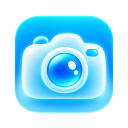

# Glass Recorder

A private, offline camera recorder for Windows and macOS. Built with Codex.

## Download version 0.1.1 — preview

Self-contained desktop apps for Windows and macOS: no Node.js, terminal, or development server required.

| Your device | Download | Included installer |
|---|---|---|
| Windows x64 | [Download for Windows](https://github.com/efter-dash/glass-recorder/actions/runs/39937136534/artifacts/12493982498) | `Glass-Recorder-0.1.1-win-x64.exe` |
| Mac with Apple Silicon (M-series) | [Download for Apple Silicon](https://github.com/efter-dash/glass-recorder/actions/runs/39937136534/artifacts/12494037453) | `Glass-Recorder-0.1.1-mac-arm64.dmg` and app ZIP |
| Mac with an Intel processor | [Download for Intel Mac](https://github.com/efter-dash/glass-recorder/actions/runs/39937136534/artifacts/12493249429) | `Glass-Recorder-0.1.1-mac-x64.dmg` and app ZIP |

**GitHub sign-in is required.** These links download GitHub Actions artifact ZIPs: extract the downloaded ZIP first to find the installer. Artifacts expire according to the repository's retention policy. If a link expires, check [Desktop builds](https://github.com/efter-dash/glass-recorder/actions/workflows/desktop.yml). A permanent public release has not yet been published; future releases will appear under [Releases](https://github.com/efter-dash/glass-recorder/releases).

### Install

- **Windows:** extract the artifact ZIP, run the `.exe`, and follow the installer.
- **Mac:** extract the artifact ZIP, open the `.dmg`, and drag Glass Recorder into Applications. The included app ZIP is an alternative. Choose Apple Silicon or Intel based on **About This Mac**.
- Open Glass Recorder and grant camera and microphone access when requested.

**Unsigned preview:** Windows SmartScreen and macOS Gatekeeper may warn or block launch. The Mac app is not notarized. Only install a build you trust; do not disable system security globally. Real-device installation and hardware testing remain necessary before a polished public release.

## What's new in 0.1.1

- A cute, glowing cyan camera icon across the app, Windows ICO, and macOS ICNS assets.
- Refined light and dark glass surfaces, softer shadows, balanced spacing, and cyan accents.
- Clear Standby, Ready, Recording, and Captured status labels.
- Accessible focus states, camera/microphone toggle states, and reduced-motion styling.
- The same offline recording workflow, native save dialog, and four aspect ratios.

<p align="center"></p>

## Recording

1. Choose an aspect ratio and turn on the camera.
2. Enable or mute the microphone, then start recording.
3. Stop, preview, and choose **Save**. The native save dialog starts in Downloads.

| Ratio | Output size |
|---|---|
| 9:16 | 1080 × 1920 |
| 3:4 | 1080 × 1440 |
| 1:1 | 1080 × 1080 |
| 16:9 | 1920 × 1080 |

The app center-crops and mirrors the recorded image to match the preview. It prefers a FaceTime camera when available, otherwise the system default. MP4 is preferred when the runtime supports it; otherwise recordings are saved as WebM with the correct extension. Format availability is detected at runtime, not promised for every device.

Recordings stay in memory until saved. Closing the app discards unsaved recordings; a confirmation appears before closing. Long recordings can consume substantial memory. Camera and microphone tracks are released when recording stops. No account, analytics, remote server, or upload is required.

## Development

Use Node.js 22 or newer:

```sh
npm ci
npm start
```

The original local React recorder has been restored into `src/`. Vite produces static assets and Electron bundles the runtime. The legacy Mac launcher that depended on a developer-specific path and a development server is not needed.

```sh
npm run build
npm test
npm run pack                 # unpacked app for the current platform
npm run dist -- --mac --arm64
npm run dist -- --mac --x64
npm run dist -- --win --x64   # run on Windows
```

Output is written to `release/`. Electron runs with renderer sandboxing and context isolation, without Node.js access in the UI. Permissions are restricted to media requests from the bundled app. A restrictive content security policy blocks network connections and external navigation is disabled.

## Releases and verification

`.github/workflows/desktop.yml` builds on macOS and Windows runners. Pushes to `main` and pull requests produce downloadable workflow artifacts. A `v*` tag builds all three targets and creates a **draft** GitHub release; it does not publish automatically. Match the tag to the version in `package.json`.

### Verified for this preview

[Build run 39937136534](https://github.com/efter-dash/glass-recorder/actions/runs/39937136534) passed all three installer jobs: Windows x64, macOS arm64, and macOS x64. TypeScript, production builds, packaging checks, and simulated camera/microphone recording tests passed. Tests cover all four output resolutions, playback, native file saving, repeated recordings, and capture-device cleanup. The icon and light/dark UI were also visually inspected locally.

The Intel installer was built successfully, but the Mac CI runtime test uses its host architecture; this does not establish physical Intel Mac compatibility or real-camera behavior. Installers remain previews.

### Before public release

- Test installation and real camera/microphone capture on Windows, Intel Mac, and Apple Silicon Mac.
- Check all four ratios, audio/mute, replay, save cancellation, repeated recordings, denied permissions, and quitting with unsaved work.
- Configure Apple Developer ID signing and notarization and Windows code signing using protected CI secrets. The preview workflow currently disables automatic signing identity discovery.
- Publish the draft release only after checking its installers and limitations.

## The Story

I was struggling to record videos using Photo Booth, the recording app included with macOS. It didn’t offer the aspect ratios I needed, and saving or locating recordings took more effort than it should have.

A simple recording task was wasting too much time, so I thought:

> What if I made an app that records in different aspect ratios and saves videos directly to Downloads?

Glass Recorder grew from that idea into an offline desktop app with a save dialog that starts in Downloads.

I originally created it for myself—and for anyone else who appreciates this tiny bit of convenience.


[Watch the original demo](https://youtu.be/WTAsm1nJCpY)
